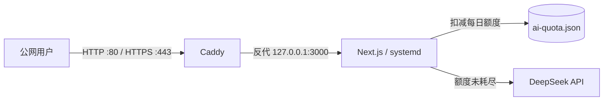

# 腾讯云轻量应用服务器部署指南

本文记录在本项目中实际验证过的 Linux 单机部署方式，适用于腾讯云轻量应用服务器或其他可直接登录的 Ubuntu 云主机。示例中的服务器地址、登录用户、密钥路径和域名均为占位符，请替换为你自己的信息。

## 架构



- Caddy 是唯一公网入口，负责静态资源压缩、反向代理和后续 HTTPS。
- Next.js 只监听回环地址 `127.0.0.1:3000`，不直接暴露到公网。
- systemd 负责进程守护、开机启动和故障重启。
- 本地排盘在浏览器完成；常规排盘和页面展示不需要下载 v4.0 解读数据集。

## 已验证环境

- Ubuntu Server 24.04 LTS，x86_64
- 4 核 CPU、8 GB 内存、180 GB 磁盘
- Node.js `v22.23.3`、npm `10.9.9`
- Caddy 2、systemd
- 部署后通过类型检查、排盘回归、生产构建和公网浏览器验证

Node.js 大版本变化后应重新执行本文的验证命令，不要只依赖本机开发环境的验证结果。

## 1. 准备服务器

在云控制台完成：

1. 创建或选择 Ubuntu 云服务器。
2. 配置 SSH 密钥登录，并在本地确认可以执行 `ssh <ssh-user>@<server-public-ip>`。
3. 防火墙或安全组按需开放：

| 端口 | 来源 | 用途 |
|---|---|---|
| TCP 22 | 管理端公网 IP | SSH 管理 |
| TCP 80 | `0.0.0.0/0` | HTTP |
| TCP 443 | `0.0.0.0/0` | HTTPS，有域名后使用 |

不要向公网开放应用自身的 `3000` 端口。若只允许特定人员访问，应把 80/443 的来源也限制为固定 IP，或在反向代理层增加身份验证。

Ubuntu 内网防火墙默认未启用时，公网访问仍可能被云平台防火墙拦截。页面内部返回 200、外部连接超时时，应先检查云控制台的防火墙或安全组。

## 2. 获取代码

推荐使用 Git 克隆：

```bash
mkdir -p "$HOME/apps"
git clone --branch test --single-branch <repository-url> "$HOME/apps/ziwei-doupan"
cd "$HOME/apps/ziwei-doupan"
```

如果云服务器无法稳定访问 GitHub，而 `github.com` 克隆出现 TLS 中断，可先验证 GitHub 的 `codeload` 下载地址是否可用，再下载对应分支的源码压缩包：

```bash
curl -fL --retry 4 --retry-delay 3 \
  -o /tmp/ziwei-source.tar.gz \
  "https://codeload.github.com/<owner>/<repository>/tar.gz/refs/heads/<branch>"

mkdir -p "$HOME/apps/ziwei-doupan"
tar -xzf /tmp/ziwei-source.tar.gz \
  -C "$HOME/apps/ziwei-doupan" \
  --strip-components=1
```

压缩包方式没有 Git 历史。项目中的 `neutral-naming` 回归依赖 `git ls-files`，此时需要在应用目录初始化本地仓库，才能完整运行 `npm test`：

```bash
git init -b <branch>
git add .
git -c user.name="Ziwei Deploy" \
    -c user.email="deploy@localhost" \
    commit -m "deploy: <commit-or-version>"
```

`.env.local` 已被 `.gitignore` 忽略，提交前可用 `git status` 和 `git ls-files | grep -E "(^|/)\.env"` 再核对一次。

## 3. 安装依赖并配置环境变量

```bash
cd "$HOME/apps/ziwei-doupan"
npm ci --no-audit --no-fund
cp .env.example .env.local
chmod 600 .env.local
```

编辑 `.env.local`：

```env
AI_PROVIDER=deepseek
DEEPSEEK_API_KEY=<your-deepseek-api-key>
DEEPSEEK_BASE_URL=https://api.deepseek.com
DEEPSEEK_MODEL=deepseek-chat
AI_QUOTA_DAILY_LIMIT=500
AI_QUOTA_CONTACT=<admin-contact>
AI_QUOTA_STORE=/var/lib/ziwei-doupan/ai-quota.json
NEXT_PUBLIC_SITE_URL=http://<server-public-ip>
```

注意事项：

- 密钥只放在服务器的 `.env.local`，权限设为 `600`，不要写入源码、提交记录、截图或客户端环境变量。
- 没有域名时填 `http://<server-public-ip>`；启用域名和 HTTPS 后改为 `https://<your-domain>`。
- `NEXT_PUBLIC_*` 变量会在构建时进入前端产物，修改后必须重新执行 `npm run build`。
- 未配置 DeepSeek 密钥时，排盘仍可使用，但 AI 解读接口不可用。
- `AI_QUOTA_CONTACT` 会直接展示给用户，正式公开前应改成真实的邮箱、微信号或其他联系方式。
- `AI_QUOTA_DAILY_LIMIT` 默认 `500`，按北京时间每日 00:00 重置；设为非正整数时会回退到默认值。

### AI 每日额度

额度在服务端调用 DeepSeek 之前统一扣减，`/api/interpret` 与 `/api/heming` 共用同一个每日计数器。达到上限后接口返回 `429`，不会发起模型请求。DeepSeek 连接失败或明确拒绝时自动退还当次额度；已开始生成或用户主动断开则保留计数。

额度记录默认保存在项目 `.data/ai-quota.json`，生产环境建议使用 `AI_QUOTA_STORE=/var/lib/ziwei-doupan/ai-quota.json`，并通过 systemd 的 `StateDirectory` 创建可写目录。该实现适用于单机单进程；如果以后部署多个应用实例，应改用 Redis 或数据库做共享计数。

在应用目录查看和管理今日额度：

```bash
npm run ai-quota -- status
npm run ai-quota -- reset
npm run ai-quota -- add 100
```

这些命令会读取 `.env.local`。如果额度文件损坏或不可写，AI 接口会失败关闭，不会在未计数的情况下调用模型。

## 4. 构建前验证

```bash
npm run typecheck
npm test
npm run build
```

三项都应通过后再配置线上服务。不要在构建失败时覆盖正在运行的服务。

## 5. 配置 systemd

创建 `/etc/systemd/system/ziwei-doupan.service`：

```ini
[Unit]
Description=Ziwei Doupan Next.js
After=network-online.target
Wants=network-online.target

[Service]
Type=simple
User=<ssh-user>
Group=<ssh-user>
WorkingDirectory=/home/<ssh-user>/apps/ziwei-doupan
StateDirectory=ziwei-doupan
Environment=NODE_ENV=production
Environment=NEXT_TELEMETRY_DISABLED=1
Environment=PORT=3000
Environment=HOSTNAME=127.0.0.1
EnvironmentFile=/home/<ssh-user>/apps/ziwei-doupan/.env.local
ExecStart=/usr/bin/node /home/<ssh-user>/apps/ziwei-doupan/node_modules/next/dist/bin/next start --hostname 127.0.0.1 --port 3000
Restart=on-failure
RestartSec=5
TimeoutStopSec=20
NoNewPrivileges=true
PrivateTmp=true
ProtectSystem=full

[Install]
WantedBy=multi-user.target
```

加载并启动：

```bash
sudo systemctl daemon-reload
sudo systemctl enable --now ziwei-doupan
sudo systemctl status ziwei-doupan --no-pager
curl -I http://127.0.0.1:3000/
```

`NEXT_TELEMETRY_DISABLED=1` 关闭 Next.js 自身匿名的构建遥测，避免部署环境产生额外上报。

## 6. 配置 Caddy

先确认 `80/443` 当前属于谁，不要直接覆盖未知服务：

```bash
sudo ss -ltnp | grep -E ":(80|443)\b"
```

如果 Caddy 正在提供默认欢迎页，可以备份后替换。无域名时：

```caddyfile
:80 {
	encode zstd gzip
	header {
		X-Content-Type-Options nosniff
		Referrer-Policy strict-origin-when-cross-origin
	}
	reverse_proxy 127.0.0.1:3000
}
```

有域名时应改用域名站点，让 Caddy 自动申请 HTTPS 证书：

```caddyfile
<your-domain> {
	encode zstd gzip
	header {
		X-Content-Type-Options nosniff
		Referrer-Policy strict-origin-when-cross-origin
	}
	reverse_proxy 127.0.0.1:3000
}
```

安装前先校验并保留回滚文件：

```bash
sudo cp -a /etc/caddy/Caddyfile "/etc/caddy/Caddyfile.bak-$(date +%Y%m%d-%H%M%S)"
sudo install -m 644 <new-caddyfile> /etc/caddy/Caddyfile
sudo caddy validate --config /etc/caddy/Caddyfile
sudo systemctl reload caddy
curl -I http://127.0.0.1/
```

只监听 `:80` 时，Caddy 日志中的 `automatic HTTPS will not be applied` 是预期提示，不是启动失败。

## 7. 公网验证

从外部网络检查，不要只测试服务器本机：

```bash
curl -I http://<server-public-ip>/
curl -I http://<server-public-ip>/chart
curl -I http://<server-public-ip>/heming
```

至少验证：

- 首页、`/chart`、`/heming` 返回 HTTP 200。
- 桌面和手机宽度下无横向溢出。
- 排盘、十二宫选择、大限/流年、主题切换正常。
- 浏览器控制台无错误，页面不请求未预期的第三方域名。
- AI 功能使用本地模拟 SSE 回归，不在常规测试中消耗真实 DeepSeek 额度。

若服务器本机 200、外部超时，依次检查云防火墙、安全组、运营商网络和本地代理。

## 8. 更新部署

Git 部署方式的常规流程：

```bash
cd "$HOME/apps/ziwei-doupan"
git pull --ff-only
npm ci --no-audit --no-fund
npm run typecheck
npm test
npm run build
sudo systemctl restart ziwei-doupan
sudo systemctl status ziwei-doupan --no-pager
```

更新前确认目标分支和提交号，并检查 `.env.local` 不会被覆盖。构建期间旧服务可以继续运行；构建成功后再重启，能减少停机时间。

## 9. 常见问题

### 公网连接超时，但服务器本机返回 200

检查腾讯云防火墙或安全组是否放行 80/443，并确认规则来源范围。服务器自身 `ufw` 未启用不代表云平台没有外层防火墙。

### GitHub 克隆报 `GnuTLS recv error (-110)`

常见于云服务器到 GitHub 的网络链路不稳定。可重试、改用 `codeload` 源码包，或通过企业代理获取代码。不要从不明第三方镜像下载后直接部署。

### 压缩包部署后 `npm test` 报 `not a git repository`

`neutral-naming` 回归会读取 `git ls-files`。按第 2 节初始化本地 Git 基线后重新运行测试。

### Windows 私钥提示 `UNPROTECTED PRIVATE KEY FILE`

Windows OpenSSH 会检查私钥 ACL。把私钥放到用户目录，并只授予当前 Windows 用户读取权限，不要用 Git Bash 的 `chmod` 代替 Windows ACL。

### 修改域名或站点地址后页面仍是旧地址

`NEXT_PUBLIC_SITE_URL` 在构建时写入产物。修改 `.env.local` 后必须重新构建并重启服务。

## 10. 安全与后续扩展

当前部署默认**没有登录鉴权**。配置 DeepSeek 密钥后，任何能访问站点的人都可能消耗你的模型额度。每日额度是成本保险丝，不是访问控制；当前策略没有单 IP 限额，单个访客仍可能耗尽当日全部额度。

如果需要限制访问，应至少选择一种保护：

- Caddy Basic Auth
- 反向代理层接入统一身份认证
- 云防火墙限制访问来源 IP

后续部署多个服务时，推荐使用**一个主域名 + 每个服务一个子域名**，每个应用监听不同的 `127.0.0.1:<port>`，由同一个 Caddy 按 Host 转发：

```caddyfile
ziwei.<your-domain> {
	reverse_proxy 127.0.0.1:3000
}

tool.<your-domain> {
	reverse_proxy 127.0.0.1:3001
}
```

公网只需开放 80/443。Caddy 可分别管理各站点 HTTPS 证书。不要轻易使用 `/service-a` 这类路径前缀区分 Next.js 应用，因为静态资源和跳转通常按根路径生成；确有需要时应为每个应用配置 `basePath`。

腾讯云中国大陆服务器绑定域名通常需要 ICP 备案。若使用海外或中国香港地域，应另行确认当地网络与合规要求。

## 脱敏说明

本文不记录真实服务器公网 IP、SSH 用户名、私钥路径、域名、DeepSeek API Key 或其他登录凭证。请勿在实际部署记录、Issue、截图或提交中补充这些信息。
